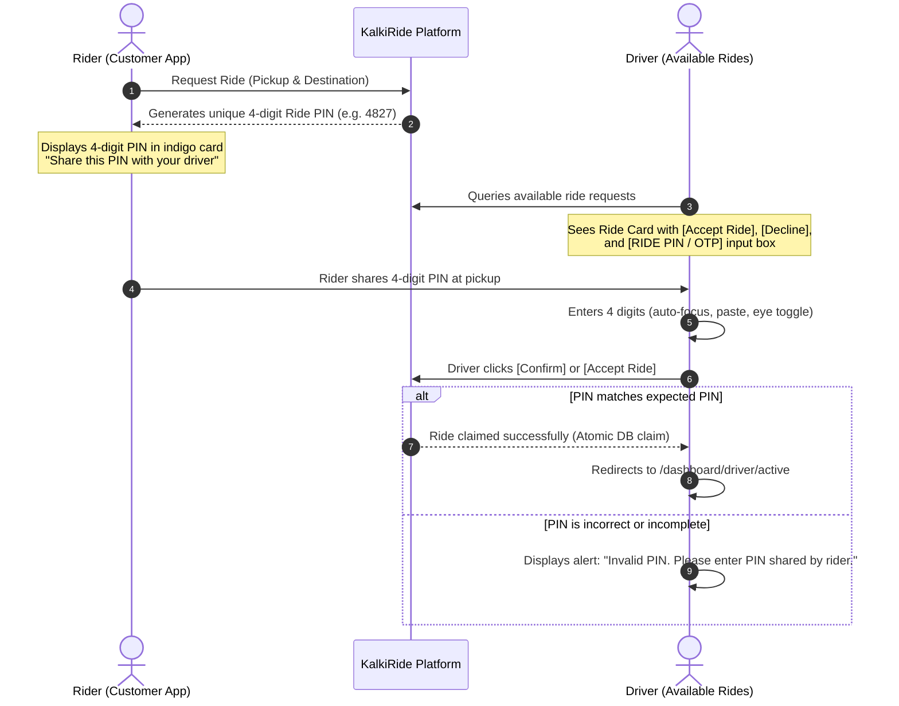

# KalkiRide 🚗⚡

A modern, full-stack, enterprise-grade ride-hailing web platform built with **Next.js 16 (App Router)**, **TypeScript**, **Tailwind CSS**, **Supabase (PostgreSQL)**, **Leaflet Maps**, and **OpenStreetMap / OSRM**.

---

## 🏛️ Industry-Standard Clean Architecture

The codebase is organized into an **Industry-Standard Layered Clean Architecture**. All business logic, database queries, type definitions, validation schemas, and UI components are strictly decoupled into dedicated, single-responsibility folders.

### 📂 Directory Structure


```
kalki-ride-app/
├── app/                      # Next.js App Router (Routing, Layouts, Server Actions & REST APIs)
│   ├── actions/              # Next.js Server Actions (form controllers for auth & rides)
│   ├── api/                  # RESTful API Endpoints
│   │   ├── auth/             # /api/auth/login, signup, logout, session, google, google/callback
│   │   ├── customer/         # /api/customer/rides, /api/customer/rides/[id]
│   │   └── driver/           # /api/driver/rides, active, accept, complete, location, stats
│   ├── dashboard/
│   │   ├── customer/         # Customer account portal (profile, membership status, trip history)
│   │   └── driver/           # Driver portal routes (active, history, profile, rides, vehicle)
│   ├── login/ & signup/      # Authentication pages (page.tsx with Google OAuth & Email/Password)
│   ├── ride-details/         # Dedicated route planner & live driver tracking portal (page.tsx)
│   ├── globals.css           # Global stylesheet & Tailwind configuration
│   ├── layout.tsx            # Root HTML shell & Toast provider
│   └── page.tsx              # Home / Unified Single-Page Marketplace (UnifiedRideView)
├── components/               # Modular UI Presentation Layer (Domain-Driven)
│   ├── common/               # AnimatedVehicleMap (real-time moving SVG vehicle), AuthHeader, ToastProvider
│   ├── customer/             # BookingForm, DriverTrackingMap, RideWaiting, LocationInput
│   ├── driver/               # DriverNav, ActiveRideCard, DriverNavMap, RideCard, VehicleForm, ProfileForm
│   └── marketplace/          # Unified Marketplace Presentation
│       ├── unified-ride-view.tsx      # Main Single-Page mobile & desktop unified dashboard
│       ├── kalki-map.tsx              # Interactive Leaflet OpenStreetMap canvas
│       ├── kalki-booking-card.tsx     # Floating booking card with inline debounced suggestions
│       ├── kalki-vehicle-selector.tsx # Vehicle options (Bike, Auto, Cab) with live fares
│       ├── kalki-quick-actions.tsx    # 4-card action grid (Rentals, Outstation, Intercity, Reserve)
│       ├── kalki-promo-banner.tsx     # Promotional offer banner with copyable codes
│       ├── kalki-rider-status-view.tsx# Live Rider Status screen (PIN, Driver, Route, Moving Map)
│       ├── kalki-bottom-nav.tsx       # Bottom Navigation Bar (Home, Ride, Offers, Profile)
│       ├── kalki-top-bar.tsx          # Top bar with location pill, active badge & profile
│       └── drawers/                   # Slide-over drawers (Profile, Rides, Booking, Offers, Saved Places)
├── schemas/                  # Zod Input Validation Schemas
├── services/                 # Business Logic & Data Access Layer (Single Responsibility)
│   ├── auth.service.ts       # Cryptographic password hashing, user registration, JWT sessions
│   ├── google-auth.service.ts# Google OAuth 2.0 URL generation, token exchange & profile fetch
│   ├── ride.service.ts       # Trip lifecycle: creation, driver assignment, telemetry tracking, history
│   ├── pricing.service.ts    # Dynamic rate calculation & active platform rates
│   ├── fare.service.ts       # Pure fare estimation calculation (client & server safe)
│   └── location.service.ts   # Photon reverse-geocoding & OSRM driving route calculation
├── types/                    # Pure TypeScript Interfaces & Types
├── lib/                      # Infrastructure & Database Singletons (Supabase PostgreSQL client)
├── ARCHITECTURE.md           # In-depth architectural design, data-flow diagrams & college guide
└── README.md                 # Project documentation & quick start
```

---

## 🧩 Architectural Layers & Responsibilities

| Layer | Directory | Responsibility | Example |
| :--- | :--- | :--- | :--- |
| **Presentation** | `components/` | Reusable React UI components grouped by functional domain. Purely responsible for rendering and user interactions. | `components/customer/booking-form.tsx` |
| **Routing & Actions** | `app/` | Thin Next.js page shells, layouts, Server Actions (`app/actions/`), and REST API route handlers (`app/api/`). | `app/ride-details/page.tsx` |
| **Validation** | `schemas/` | Strict runtime input validation using Zod to sanitize client input before it reaches database or server operations. | `schemas/ride.schema.ts` |
| **Business Logic** | `services/` | Centralized business logic, database queries, cryptographic hashing, and external API integrations (OSRM, Photon). | `services/ride.service.ts` |
| **Type Definitions** | `types/` | Compile-time TypeScript interfaces and domain shapes. Completely detached from runtime code. | `types/ride.ts` |
| **Infrastructure** | `lib/` | Low-level client initializations and database connections. All legacy re-export shims have been cleaned up. | `lib/supabase.ts` |

---

## 🌟 Key Application Flows

### 1. Unified Single-Page Marketplace Experience (`UnifiedRideView`)
- **Interactive OpenStreetMap Canvas**: Full-width interactive Leaflet map featuring real-time pin placement, marker dragging, zoom controls, and automatic size invalidation.
- **Auto-Location on Launch**: Automatically fetches user's GPS coordinates on page mount and reverse-geocodes them to a readable street address using Komoot Photon.
- **Zero-Friction Search & Selection**: Clean, debounced autocomplete with active typing detection (`isTypingPickupRef`, `isTypingDestRef`) preventing repetitive dropdown popups or duplicate clicks.
- **Dynamic Vehicle Matrix**: Real-time fare calculation for Kalki Bike, Auto Rickshaw, and Cab with ride features.
- **Bottom Navigation Bar**: Native app feel on mobile and desktop with 1-tap switching between **Home**, **Ride** (Status/History), **Offers**, and **Profile**.

### 2. Live Rider Status & Verification Flow (`KalkiRiderStatusView`)
- **Direct Redirect on Booking**: When a customer confirms a ride, they are immediately brought to the dedicated Rider Status screen without intermediary screens.
- **Dynamic Broadcasting Radar**: Displays live broadcast status targeted dynamically to the user's pickup city/locality (e.g., *"Contacting Nearby Drivers in Delhi..."*).
- **Deterministic 4-Digit Verification PIN**: Displayed prominently for the customer to share with the driver to start the trip.
- **Dynamic Driver & Vehicle Details**: Shows authentic assigned driver details (name, rating, phone number with direct call action, make, model, color, and license plate number). No fake or hardcoded mock placeholders.
- **Home Return Guard**: If the user navigates back to Home during an active ride, an intuitive floating banner appears enabling instant 1-tap return to the live trip tracker.

### 3. Animated Real-Time Vehicle Navigation (`AnimatedVehicleMap`)
- **Smooth Road Navigation**: Utilizes `densifyRoute` to interpolate continuous micro-waypoints along the OSRM driving route so vehicles glide realistically without jumping.
- **Dynamic Bearing Rotation**: Calculates spherical heading angles (`calculateBearing`) along road segments, rotating the vehicle SVG to face the road direction through turns.
- **Custom Authentic SVGs**: Detailed Auto Rickshaw (Bajaj RE 3-wheeler), Taxi Cab (sedan with taxi roof sign), and Kalki Bike (rider helmet and handlebars).
- **Two-Way Synchronization**: Synchronized on both Customer tracking (`KalkiRiderStatusView`, `DriverTrackingMap`) and Driver navigation (`ActiveRideCard`, `DriverNavMap`).
- **PIN Transition Trigger**: Once the driver enters the customer's PIN, status transitions to `in_progress` and navigation immediately routes from current location toward the destination.

### 4. Dedicated Customer Portal (`/dashboard/customer`)
- Preserved specifically for customer personal data, account status, and ride history.
- Displays full trip history with date receipts, distance in kilometers, statuses (`requested`, `accepted`, `in_progress`, `completed`), and fare totals.

### 5. Top-Right Profile Dropdown Menu (`AuthHeader`)
- Cleans up the top navigation bar by removing centered clutter.
- Features a top-right profile avatar with verified badge, user name, and dropdown menu containing:
  - **Book a ride** (`/ride-details`)
  - **Account & History** (`/dashboard/customer`)
  - **Log out** action

---

## 📍 Location Search & Geolocation Architecture

The location search subsystem ([`components/marketplace/location-field.tsx`](components/marketplace/location-field.tsx)) has been engineered to production standards. This guide explains how it works so all team members can understand, maintain, and extend it.

### 1. Root Cause Analysis: The Dropdown Overlap Bug
**The Problem:**
Previously, when a user clicked the Pickup input and then clicked the Destination input, both dropdown lists stayed open at the same time, covering the distance banner ("53.0 km") and the interactive route preview map.

**The Solution:**
1. **Global Outside Click Listener (`useRef` + `pointerdown`)**:
   ```tsx
   useEffect(() => {
     function handlePointerDown(event: MouseEvent | TouchEvent) {
       if (containerRef.current && !containerRef.current.contains(event.target as Node)) {
         setOpen(false); // Closes dropdown immediately when clicking outside
       }
     }
     document.addEventListener("mousedown", handlePointerDown);
     document.addEventListener("touchstart", handlePointerDown);
     return () => {
       document.removeEventListener("mousedown", handlePointerDown);
       document.removeEventListener("touchstart", handlePointerDown);
     };
   }, []);
   ```
2. **Escape Key Handling**: Pressing `Escape` automatically dismisses the dropdown and blurs the input.
3. **Selection State Flag (`isPlaceSelected`)**: Once a place is selected, the dropdown closes and does not re-open when clicking or focusing the input unless the user actively edits or clears the text.

---

### 2. "Use Current Location" Geolocation Pipeline
Riders can auto-detect their current pickup location with 1 click:

```
[Rider Clicks "Use Current Location"]
           │
           ▼
[Browser Geolocation API] ────► navigator.geolocation.getCurrentPosition()
           │                    (High accuracy GPS coordinates: lat, lng)
           ▼
[Location Service] ───────────► services/location.service.ts -> reverseGeocode(lat, lng)
           │                    (Komoot Photon Open API: https://photon.komoot.io/reverse)
           ▼
[Place Suggestion Model] ─────► { id, displayName: "Hospital, Ghaziabad, UP", lat, lng }
           │
           ▼
[State & Input Sync] ─────────► onSelect(place) + onChange(place.displayName)
```

**Key Geolocation Safeguards:**
- **Permission Denials**: Informative toast message if location permissions are blocked in the browser.
- **Reverse Geocode Fallback**: If reverse geocoding returns no address features, gracefully falls back to formatted coordinates (`Current Location (lat, lng)`).
- **Dual Trigger Points**: Available both as a prominent option inside the dropdown and as a direct GPS target icon button inside the input field.

---

### 3. Production Route Constraints & Validation

| Feature / Constraint | Behavior | Location |
| :--- | :--- | :--- |
| **Contextual Live Search Indicator** | Dynamically adapts feedback based on input context: shows *"Searching pickup location... for '{query}'"* (blue theme) for pickup, and *"Searching destination location... for '{query}'"* (orange theme) for destination while geocoding is in flight. | `components/marketplace/location-field.tsx` |
| **Identical Locations** | Blocks booking & displays toast: *"Pickup and destination cannot be the same location."* | `components/customer/booking-form.tsx`, `components/marketplace/hero-section.tsx` |
| **Minimum Query Length** | Only fires geocoding search when query is $\ge 2$ characters. | `components/marketplace/location-field.tsx` |
| **Request Debouncing** | 280ms debounce with `AbortController` cancellation for rapid keystrokes. | `components/marketplace/location-field.tsx` |
| **Contextual Empty State** | Displays tailored notices (*"No matching pickup places found"* / *"No matching destination places found"*) when no results are found. | `components/marketplace/location-field.tsx` |
| **Active Ride Guard & Hover Overlay** | If a customer already has an active ride in progress (`requested`, `accepted`, `in_progress`), the "Book my ride" button is disabled. Hovering over the entire "Where are you going?" card reveals a message (*"You already booked a ride! Click anywhere to check into your My Rides"*). Clicking redirects to `/ride-details` with an informative toast notice. | `components/marketplace/hero-section.tsx` |
| **Quick Clear Button `(×)`** | Clears text, resets selection state (`onSelect(null)`), and refocuses input. | `components/marketplace/location-field.tsx` |
| **Keyboard Accessibility** | Supports `ArrowDown`, `ArrowUp`, and `Enter` to navigate and choose items. | `components/marketplace/location-field.tsx` |


---

### 4. Component Props Reference (`LocationField`)

```tsx
interface LocationFieldProps {
  value: string;                            // Current input text string
  placeholder: string;                      // Input placeholder text
  dotClassName: string;                     // Tailwind styling for origin/destination dot
  onChange: (value: string) => void;        // Text change handler
  onSelect: (place: PlaceSuggestion | null) => void; // Selected place callback
  showCurrentLocation?: boolean;            // Enable/disable GPS action (default: true)
  disabled?: boolean;                       // Disable interaction
  fieldType?: "pickup" | "destination";     // Contextual type determining search & empty labels
}
```

---

## 🛡️ Ride PIN (OTP) & Duration Conversion System

### 1. Overview
To ensure ride security, prevent driver-rider mismatch, and improve user experience, KalkiRide includes an **end-to-end Ride PIN (OTP) verification handshake** and **human-friendly duration formatting** across both Rider and Driver dashboards.

### 2. Ride PIN / OTP Verification Lifecycle


### 3. Implementation Highlights
| Feature | Details | File Reference |
| :--- | :--- | :--- |
| **Deterministic PIN Generator** | 32-bit FNV hash mapping `rideId` to stable 4-digit numeric code (`1000–9999`). Guarantees customer and driver screens stay 100% synchronized in real time. | [`lib/format.ts`](file:///Users/shubhamjaiswal/Downloads/kalki-ride-app/lib/format.ts) |
| **Customer PIN Card** | Indigo-themed card displaying 4 bold digit tiles and sharing instructions. | [`components/customer/ride-waiting.tsx`](file:///Users/shubhamjaiswal/Downloads/kalki-ride-app/components/customer/ride-waiting.tsx) |
| **Driver Verification Box** | Green-themed card with 4 individual digit inputs, auto-advancing focus, backspace navigation, paste handling, show/hide eye toggle, Decline option, and Confirm action. | [`components/driver/ride-card.tsx`](file:///Users/shubhamjaiswal/Downloads/kalki-ride-app/components/driver/ride-card.tsx) |
| **Duration Conversion (`formatDuration`)** | Converts raw minute numbers into clean, human-friendly strings: <br/>• `45` &rarr; `"45 min"`<br/>• `60` &rarr; `"1 hr"`<br/>• `203` &rarr; `"3 hr 23 min"`<br/>• `5313` &rarr; `"88 hr 33 min"` | [`lib/format.ts`](file:///Users/shubhamjaiswal/Downloads/kalki-ride-app/lib/format.ts) |
| **Ride Cancellation Handshake** | Allows customers to safely cancel requested or in-progress trips with instant UI reset back to route planning. Supported across UI buttons in `/ride-details`, Server Actions (`cancelCustomerRide`), and REST API (`POST/DELETE`). Uses a database-compliant cancellation epoch marker (`completed_at = 1970-01-01`, `fare = 0`) to comply with PostgreSQL's strict `rides_status_check` constraint without table permission issues. | [`components/customer/ride-waiting.tsx`](file:///Users/shubhamjaiswal/Downloads/kalki-ride-app/components/customer/ride-waiting.tsx), [`services/ride.service.ts`](file:///Users/shubhamjaiswal/Downloads/kalki-ride-app/services/ride.service.ts) |

---

## 🌐 REST API Endpoints

In addition to Next.js Server Actions, the application provides standard industry REST API endpoints matching web and mobile client conventions:

### Authentication
- `GET /api/auth/google` — Initiates Google OAuth 2.0 authorization handshake with secure CSRF state token.
- `GET /api/auth/google/callback` — Handles Google OAuth callback, code exchange, profile synchronization, and session creation.
- `POST /api/auth/login` — Authenticate user and issue encrypted session cookie.
- `POST /api/auth/signup` — Register new customer or driver with password hashing.
- `POST /api/auth/logout` — Invalidate session and clear auth cookies.
- `GET /api/auth/session` — Retrieve active authenticated user session.

### Customer
- `GET /api/customer/rides` — Fetch ride history and active bookings for the logged-in customer.
- `POST /api/customer/rides` — Create a new ride request with pickup/destination coordinates.
- `GET /api/customer/rides/[id]` — Poll status, driver assignment, and live driver GPS location.
- `POST /api/customer/rides/[id]/cancel` — Cancel an active ride request before completion.
- `DELETE /api/customer/rides/[id]` — Cancel active ride request via REST DELETE semantics.

### Driver
- `GET /api/driver/rides` — Query all available ride requests waiting for pickup.
- `GET /api/driver/rides/active` — Fetch driver's currently active in-progress trip.
- `POST /api/driver/rides/[id]/accept` — Atomically claim and accept an open ride request.
- `POST /api/driver/rides/[id]/complete` — Mark ride as completed and log earnings.
- `POST /api/driver/rides/[id]/location` — Stream real-time driver GPS coordinates.
- `GET /api/driver/stats` — Fetch driver trip counts, total earnings, and rating.

---

## 🚀 Getting Started

### 1. Prerequisites
- Node.js 18+ installed
- A [Supabase](https://supabase.com/) project with the rides & users schema
- A [Google Cloud Console](https://console.cloud.google.com/) OAuth 2.0 Web Client

### 2. Environment Configuration
Create a `.env.local` file in the project root:

```env
SUPABASE_URL=https://your-project.supabase.co
SUPABASE_SERVICE_ROLE_KEY=your-supabase-service-role-key
SESSION_SECRET=your-32-character-random-secret-key-here
NEXT_PUBLIC_SITE_URL=http://localhost:3000

# Google OAuth 2.0 Credentials
GOOGLE_CLIENT_ID=your-google-client-id.apps.googleusercontent.com
GOOGLE_CLIENT_SECRET=GOCSPX-your-google-client-secret
```

#### Google Cloud Console Setup:
1. Navigate to **APIs & Services > Credentials** in the [Google Cloud Console](https://console.cloud.google.com/).
2. Create an **OAuth 2.0 Client ID** with type **Web application**.
3. Set **Authorized JavaScript origins**: `http://localhost:3000`
4. Set **Authorized redirect URIs**: `http://localhost:3000/api/auth/google/callback`
5. Copy the Client ID and Client Secret into your `.env.local` file.

### 3. Installation & Run
```bash
# Install dependencies
npm install

# Start development server
npm run dev
```

Visit [http://localhost:3000](http://localhost:3000) to view the application.

### 4. Code Quality & Build Verification
```bash
# Run ESLint validation
npm run lint

# Compile production build
npm run build
```

---

## 🎓 Why This Structure Matters for College / Evaluators

When explaining this project to teammates, professors, or evaluators, highlight these core software engineering principles:

1. **Separation of Concerns (SoC)**: UI components (`components/`) do not execute raw SQL/database calls. Database logic is isolated inside `services/`.
2. **Defensive Programming**: All forms and endpoints validate data using Zod (`schemas/`) before touching business logic.
3. **Zero Monolithic Files**: Every file has a focused, single responsibility, eliminating 500+ line unmaintainable code files.
4. **Independent Testability**: Business services in `services/` can be unit-tested without needing to mount React DOM components.
5. **No Redundant / Dead Code**: The `app/` folder strictly contains Next.js route files, and all legacy re-export shims have been completely removed.

feat: Built Google OAuth

feat(auth): full Google OAuth support for registration and signup flow

